<!-- Header -->
<p align="center">
  
</p>

<p align="center">
  <a href="https://www.peal.dev">
    
  </a>
</p>

<p align="center">
  <a href="https://www.peal.dev"></a>
  <a href="https://x.com/robertseghedi"></a>
  <a href="https://cal.com/robert-seghedi-nuu6sg/discovery-call"></a>
  <a href="https://discord.gg/ejVTr3ZmRu"></a>
</p>

<p align="center">
  
  
  
</p>

---

### `$ whoami`

```ts
const robert = {
  role: "co-founder @ peal.dev",
  location: "Romania 🇷🇴 — land of fast internet & devs who ship at 3am",
  building: "Next.js starter kits where auth, payments, db & emails actually talk to each other",
  philosophy: "built once, properly — too stubborn to do the same boring work twice",
  funding: null, // no VC, no investors. just two devs who care about code quality
  fuel: "coffee #347 (we stopped counting)",
  currently: "🔶 Clauding...",
};
```

### 🧰 Stack

<p align="center">
  
</p>

<p align="center">
  
  
  
  
  
  
  
  
  
</p>

### 🚀 Shipping right now

| | Kit | What it kills |
|---|---|---|
| 💳 | [**Stripe Checkout Starter**](https://www.peal.dev/templates/stripe-checkout-starter) | webhooks that fire twice, reading Stripe docs for the 47th time |
| 🔐 | [**Auth Starter Kit**](https://www.peal.dev/templates/auth-starter) | OAuth callback loops, sessions dying mid-demo |
| 🧱 | [**SaaS Starter Kit**](https://www.peal.dev/templates/saas-starter) *(soon)* | auth + billing + teams + admin, rebuilt from scratch every time |

> Plain Next.js + Tailwind + shadcn. No SDK lock-in, no subscription — your code, forever.

### 📦 Old-school Laravel open source

<p align="center">
  <a href="https://github.com/robertseghedi/laravel-articles"></a>
  <a href="https://github.com/robertseghedi/laravel-autofetcher"></a>
  <a href="https://github.com/robertseghedi/laravel-notification-system"></a>
  <a href="https://github.com/robertseghedi/laravel-advanced-security"></a>
</p>

### 📊 Numbers (the vanity section)

<p align="center">
  
  
</p>

<p align="center">
  
</p>

<p align="center">
  
</p>

<p align="center">
  
</p>

### 🐍 Eating my contributions

<p align="center">
  <picture>
    <source media="(prefers-color-scheme: dark)" srcset="https://raw.githubusercontent.com/robertseghedi/robertseghedi/output/github-snake-dark.svg" />
    
  </picture>
</p>

---

<p align="center">
  <i>if peal saved you a late night or two —</i>
  <a href="https://paypal.me/robertseghedi"><b>buy me a coffee ☕</b></a>
</p>


